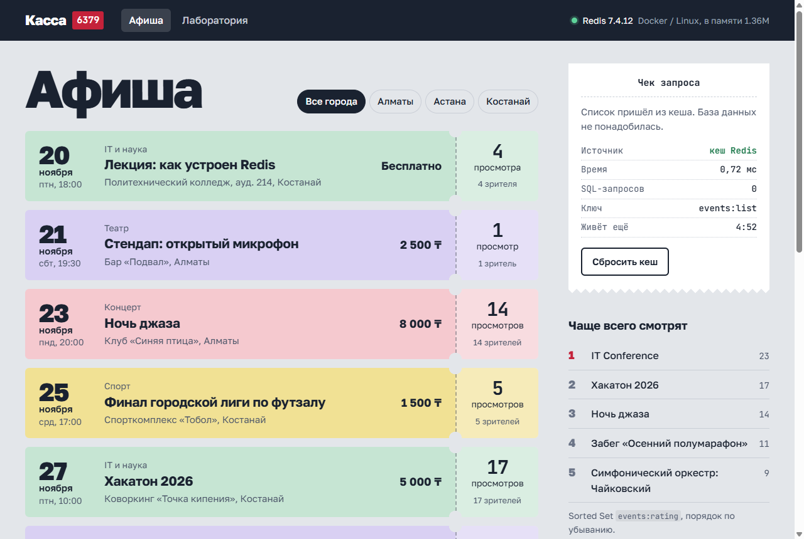
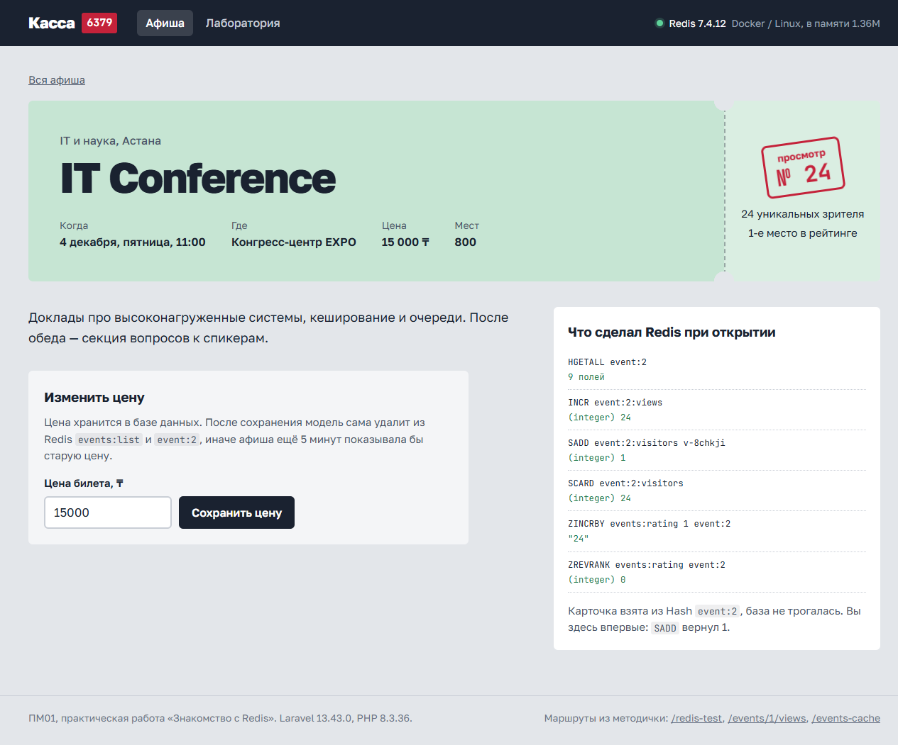
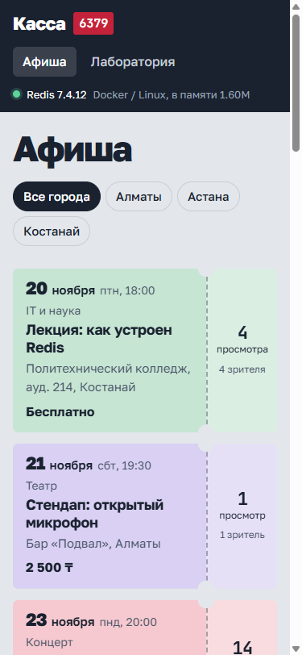

# Касса 6379

Учебный проект по ПМ01, практическая работа «Знакомство с Redis. Создание и управление данными в оперативной памяти».

Это афиша мероприятий на Laravel, в которой Redis делает видимую работу: кеширует список, считает просмотры и уникальных зрителей, строит рейтинг. Плюс «Лаборатория»: консоль redis-cli прямо в браузере, где выполняются задания 2–6 из методички, и панель, на которой видно, как ключи появляются и истекают.

Название взято от порта: Redis по умолчанию слушает 6379.




## Запуск

```bash
git clone https://github.com/MarFaus/pm01-redis-lab.git
cd pm01-redis-lab
```

Дальше просто двойной клик по **`start.bat`**. Браузер откроется сам.

Батник ничего не требует заранее. Он проверяет компьютер и докачивает то, чего не хватает:

| Шаг | Что проверяет | Если не нашёл |
|---|---|---|
| 1. PHP | `php` версии 8.3+ с нужными расширениями | качает переносной PHP 8.3, включает расширения, при необходимости ставит Visual C++ Runtime |
| 2. Composer | `composer` в системе | качает `composer.phar` и ставит пакеты из `composer.lock` |
| 3. `.env` | файл настроек | создаёт из `.env.example` и генерирует `APP_KEY` |
| 4. База | `database/database.sqlite` | создаёт, накатывает миграции, заполняет 12 мероприятиями |
| 5. Redis | порт 6379 | запускает контейнер `redis-learning` в Docker, как в методичке. Если Docker нет, предлагает поставить его через winget или запускает переносной Redis для Windows |
| 6. Сайт | свободный порт с 8000 | `php artisan serve` и открывает браузер |

Всё скачанное лежит в `.tools/` и в git не попадает. Повторный запуск занимает несколько секунд.

Остановить сайт: закрыть окно или нажать Ctrl+C. Остановить Redis: **`stop.bat`**.

Нужны только Windows 10/11 и интернет при первом запуске. Права администратора нужны только для установки Docker или Visual C++ Runtime, и батник спросит о них через окно UAC.

## Что есть в проекте

### Афиша

Каждое мероприятие сделано как кассовый билет: цвет бумаги зависит от категории, а на корешке написано, сколько раз билет открывали и сколько было разных зрителей. Справа лежит «чек запроса». Он показывает, откуда пришёл список, за сколько миллисекунд и сколько SQL-запросов понадобилось. Первый заход после сброса кеша идёт в базу (около 18 мс, 1 запрос), следующие берутся из Redis (около 0,5 мс, 0 запросов). Цифры настоящие и меряются на каждом запросе.

### Страница мероприятия



При открытии страницы на корешке появляется штамп с номером просмотра. Справа выводится журнал: какие команды Redis выполнились и что они вернули. Если открыть страницу второй раз из того же браузера, `SADD` вернёт 0 и уникальных зрителей не прибавится.

Здесь же можно поменять цену. После сохранения модель удаляет из Redis `events:list` и `event:{id}`, поэтому старая цена не висит в кеше ещё 5 минут. Это ответ на вопрос из дополнительного задания.

### Лаборатория


- **Задания 2–6** из методички. Команды кликаются: одинарный клик подставляет команду в консоль, двойной сразу выполняет. Кнопка «Проверить задание» смотрит на реальное содержимое Redis и говорит, что сделано, а чего не хватает.
- **Консоль** работает как `redis-cli`: кавычки, кириллица, история по стрелке ↑ и такой же формат ответов (`(integer) 3`, `(nil)`, нумерованные списки).
- **Панель ключей** показывает тип, TTL и значение каждого ключа. TTL тикает каждую секунду, истёкшие ключи исчезают. Перебор идёт через `SCAN`, а не через `KEYS *`. Вкладка «Сайт» показывает, что хранит в Redis сама афиша.

Консоль пишет в отдельную базу Redis (№ 2), поэтому даже `FLUSHDB` не сотрёт просмотры афиши. Команды, которые могут навредить (`CONFIG`, `SELECT`, `FLUSHALL`, `SHUTDOWN`, `EVAL`), запрещены. Лимит 60 команд в минуту сделан на `INCR` + `EXPIRE`, это тот самый Rate Limiting из лекции.



## Где здесь Redis

| Ключ | Тип | Где используется | TTL |
|---|---|---|---|
| `events:list` | String (кеш Laravel) | список на афише и `/events-cache` | 300 с |
| `event:{id}` | Hash | карточка мероприятия: name, city, venue, price… | 300 с |
| `event:{id}:views` | String + `INCR` | просмотры, корешок билета | нет |
| `event:{id}:visitors` | Set | уникальные зрители по cookie | нет |
| `events:rating` | Sorted Set | блок «Чаще всего смотрят», `ZREVRANGE` | нет |
| `ratelimit:lab:{посетитель}` | String + `INCR`/`EXPIRE` | лимит команд в консоли | 60 с |

Базы Redis разделены: 0 для сайта, 1 для кеша Laravel, 2 для лаборатории. Тесты используют базы 10–12 и рабочие данные не трогают.

## Соответствие методичке

| Задание | Где сделано |
|---|---|
| 1. Установка и запуск Redis | `start.bat` поднимает `redis:7` в контейнере `redis-learning`. В лаборатории это отмечено галочкой с версией сервера |
| 2. Строки | Лаборатория, задание 2, автопроверка: 4 строковых ключа |
| 3. TTL | Лаборатория, задание 3. В панели ключей видно, как ключ живёт и исчезает |
| 4. Hash | Лаборатория, задание 4. На сайте карточка мероприятия кешируется в Hash `event:{id}` |
| 5. Счётчик просмотров | Лаборатория, задание 5. На сайте `INCR event:{id}:views` при каждом открытии |
| 6. Set и Sorted Set | Лаборатория, задание 6. На сайте уникальные зрители и рейтинг |
| 7. Redis в Laravel | Predis, `.env`, маршруты [`/redis-test`](http://127.0.0.1:8000/redis-test) и [`/events/{id}/views`](http://127.0.0.1:8000/events/1/views) в `routes/web.php` |
| Доп. задание: кеширование | [`/events-cache`](http://127.0.0.1:8000/events-cache) и афиша через `Cache::remember('events:list', 300, …)`, драйвер `CACHE_STORE=redis` |

Маршруты из методички оставлены почти дословно. В `/events/{id}/views` добавлена одна строка `ZINCRBY`, чтобы рейтинг не расходился со счётчиком.

## Ответы на дополнительные вопросы

**Почему кеш снижает нагрузку на базу?** Первый запрос строит список и кладёт его в Redis. Следующие 5 минут все посетители получают готовый список из памяти, а база вообще не получает запросов. Это видно в «чеке»: SQL-запросов 0.

**Что будет, если мероприятие изменилось, а кеш остался?** Пользователи увидят старые данные, пока не истечёт TTL. Проверить можно так: поменяйте цену в базе в обход модели, например `php artisan tinker` и `DB::table('events')->where('id', 1)->update(['price' => 1])`. Афиша будет показывать старую цену, пока не нажать «Сбросить кеш» или не пройдёт 5 минут.

**Как обновлять кеш после изменения?** Удалять ключи в момент изменения. В проекте это сделано в `App\Models\Event::booted()`: на событиях `saved` и `deleted` вызывается `Cache::forget('events:list')` и `DEL event:{id}`. Следующий запрос соберёт свежий кеш.

**Почему нельзя хранить в Redis всё подряд?** Память дорогая и ограниченная, при сбое без настроенных RDB/AOF данные пропадут, и у Redis нет транзакций и связей уровня PostgreSQL. Заказы, оплаты и остатки билетов должны жить в основной базе, а Redis годится для производных и временных данных.

## Запуск вручную, без батника

```bash
composer install
copy .env.example .env
php artisan key:generate
type nul > database\database.sqlite
php artisan migrate --seed
docker run -d --name redis-learning -p 6379:6379 redis:7
php artisan serve
```

Расширение `phpredis` не нужно: проект работает через Predis (`REDIS_CLIENT=predis`), который ставится через Composer.

Чтобы перейти на PostgreSQL, как в лекции, включите в PHP расширение `pdo_pgsql`, поменяйте в `.env` блок `DB_*` на `DB_CONNECTION=pgsql` с хостом, базой и паролем и выполните `php artisan migrate --seed`. Код от этого не меняется.

## Тесты

```bash
php artisan test
```

43 теста, 166 проверок. Среди них: промах и попадание кеша, сброс кеша после смены цены, счётчики и уникальные зрители, изоляция базы лаборатории, запрет опасных команд, лимит частоты, формат ответов как в `redis-cli`, экранирование HTML, работа сайта при выключенном Redis. Тестам нужен запущенный Redis; если его нет, они пропускаются, а не падают. Сценарии ручной проверки лежат в [docs/TEST-CASES.md](docs/TEST-CASES.md).

## Если что-то пошло не так

| Что видно | Что делать |
|---|---|
| Красная полоса «Сайт работает без Redis» | Redis не запущен. Запустите `start.bat` ещё раз или `docker start redis-learning` |
| Docker Desktop долго стартует или просит войти | При первом запуске Docker нужно принять соглашение в его окне. Входить в аккаунт не обязательно |
| Не скачивается PHP или пакеты | Нужен интернет без блокировки `windows.php.net`, `github.com`, `getcomposer.org`, `packagist.org` |
| `start.bat` сразу закрывается | Запустите его из открытого окна `cmd`, тогда текст ошибки останется на экране |
| Папка проекта с русскими буквами | Работает. Переносные PHP и Redis в этом случае кладутся в `C:\Users\Public\kassa6379-tools`, потому что `php artisan serve` ломается, если сам `php.exe` лежит в папке с кириллицей |

## Устройство

```
app/Services/EventCatalog.php   кеш списка и карточек, сброс кеша
app/Services/EventStats.php     просмотры, зрители, рейтинг
app/Lab/CommandRunner.php       разбор и выполнение команд консоли
app/Lab/KeyInspector.php        SCAN + TYPE/TTL для панели ключей
app/Lab/TaskChecker.php         автопроверка заданий 2–6
routes/web.php                  маршруты сайта и маршруты из методички
scripts/start.ps1               логика start.bat
public/css/app.css              весь дизайн, без сборщиков и Node.js
```
