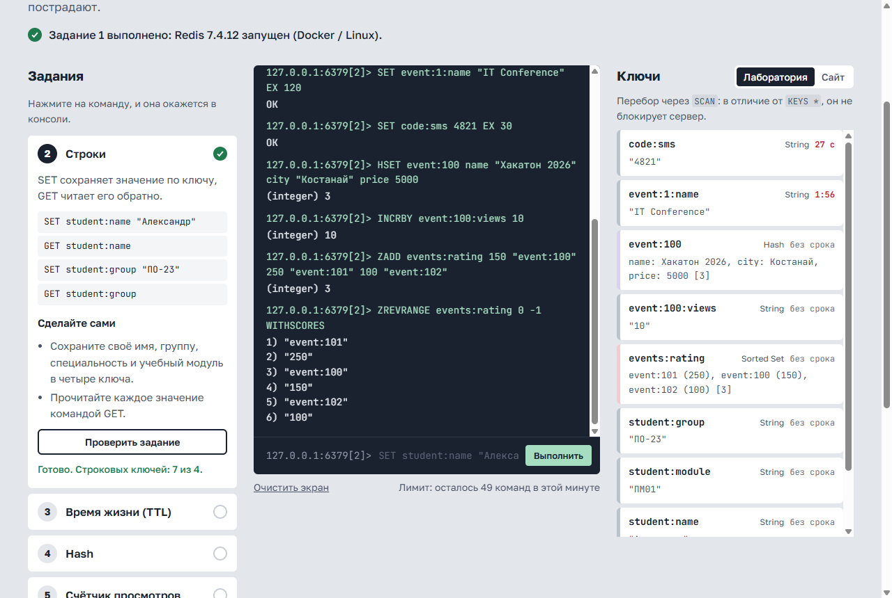

# Касса 6379

Учебный проект по ПМ01: портал продажи электронных билетов на Laravel. Каждая лабораторная работа добавляет к нему новый слой, и всё запускается одним `start.bat`.

| ЛР | Тема | Что добавилось | Раздел на сайте |
|---|---|---|---|
| [48](#лр-48-знакомство-с-redis) | Знакомство с Redis | кеш афиши, счётчики просмотров, рейтинг, консоль redis-cli в браузере | `/`, `/lab` |
| [49](#лр-49-синхронная-и-асинхронная-обработка) | Синхронная и асинхронная обработка | последовательное и конкурентное выполнение, очереди Laravel на Redis, Worker | `/queue` |
| [50](#лр-50-rabbitmq) | RabbitMQ | Producer, оформление заказов, Consumer, PDF-билеты, Direct Exchange | `/orders` |


## Запуск

```bash
git clone https://github.com/MarFaus/pm01-redis-lab.git
cd pm01-redis-lab
```

Или скачать архив: [main.zip](https://github.com/MarFaus/pm01-redis-lab/archive/refs/heads/main.zip).

Дальше двойной клик по **`start.bat`**. Ничего ставить заранее не нужно, батник сам проверит компьютер и докачает недостающее:

| Шаг | Что проверяет | Если не нашёл |
|---|---|---|
| 1. PHP | `php` 8.3+ с нужными расширениями (в том числе `sockets` для RabbitMQ) | качает переносной PHP 8.3 и включает расширения. Системный PHP из XAMPP (8.2) не используется |
| 2. Composer | — | качает `composer.phar` и ставит пакеты тем же PHP 8.3 |
| 3. `.env` | файл настроек | создаёт из `.env.example`, генерирует `APP_KEY`, ставит `QUEUE_CONNECTION=redis` |
| 4. База | `database/database.sqlite` | создаёт, накатывает миграции, заполняет 12 мероприятиями |
| 5. Redis | порт 6379 | запускает Docker-контейнер `redis-learning`. Без Docker предлагает поставить его через winget или запускает переносной Redis для Windows |
| 6. RabbitMQ | порт 5672 | запускает Docker-контейнер `rabbitmq-learning` (`rabbitmq:4-management`). Без Docker сайт работает, но сообщения в брокер не уходят |
| 7. Сайт | свободный порт с 8000 | открывает два окна, **Worker** (`queue:work redis`) и **Consumer** (`rabbitmq:consume`), запускает `php artisan serve` и браузер |

| Файл | Зачем |
|---|---|
| `start.bat` | всё запустить |
| `stop.bat` | остановить Redis и RabbitMQ |
| `tasks.bat` | ЛР 49, задания 1–2: последовательное и конкурентное выполнение в консоли |
| `rabbitmq.bat` | ЛР 50, практическая работа 1: Producer, 5 событий, Direct Exchange |

Нужны Windows 10/11 и интернет при первом запуске. Для RabbitMQ нужен Docker Desktop. Всё скачанное лежит в `.tools/` и в git не попадает.

---

## ЛР 48. Знакомство с Redis

Афиша мероприятий, где Redis кеширует список, считает просмотры и уникальных зрителей и строит рейтинг. Плюс «Лаборатория»: консоль redis-cli в браузере для заданий 2–6 и панель, на которой видно, как ключи появляются и истекают.

### Что на сайте

- **Афиша** (`/`). Каждое мероприятие сделано как кассовый билет, на корешке написано число просмотров и уникальных зрителей. Справа «чек запроса»: откуда пришёл список, за сколько миллисекунд и сколько SQL-запросов понадобилось. Первый заход после сброса кеша идёт в базу (около 18 мс, 1 запрос), следующие берутся из Redis (около 0,5 мс, 0 запросов).
- **Страница мероприятия** (`/events/{id}`). Штамп с номером просмотра и журнал команд Redis, которые выполнились при открытии. Если поменять цену, модель удалит `events:list` и `event:{id}`, поэтому старая цена не провисит в кеше 5 минут.
- **Лаборатория** (`/lab`). Задания 2–6 с кликабельными командами, консоль в формате `redis-cli`, панель ключей с тикающим TTL (перебор через `SCAN`), кнопка «Проверить задание». Консоль пишет в отдельную базу Redis № 2, опасные команды (`CONFIG`, `FLUSHALL`, `EVAL`…) запрещены, лимит 60 команд в минуту.



### Ключи Redis

| Ключ | Тип | Где используется | TTL |
|---|---|---|---|
| `events:list` | String (кеш Laravel) | список на афише и `/events-cache` | 300 с |
| `event:{id}` | Hash | карточка мероприятия | 300 с |
| `event:{id}:views` | String + `INCR` | просмотры | нет |
| `event:{id}:visitors` | Set | уникальные зрители по cookie | нет |
| `events:rating` | Sorted Set | блок «Чаще всего смотрят» | нет |
| `ratelimit:lab:{посетитель}` | String + `INCR`/`EXPIRE` | лимит команд в консоли | 60 с |

Базы Redis: 0 сайт, 1 кеш Laravel, 2 лаборатория. Тесты используют базы 10–12.

### Соответствие методичке

| Задание | Где сделано |
|---|---|
| 1. Установка Redis | `start.bat` поднимает `redis:7` в контейнере `redis-learning` |
| 2–6. Строки, TTL, Hash, счётчики, Set и Sorted Set | Лаборатория, задания 2–6 с автопроверкой. На сайте те же структуры работают на афише |
| 7. Redis в Laravel | Predis, маршруты `/redis-test` и `/events/{id}/views` в `routes/web.php` |
| Доп. задание: кеширование | `/events-cache` и афиша через `Cache::remember('events:list', 300, …)` |

### Ответы на вопросы

**Почему кеш снижает нагрузку на базу?** Первый запрос строит список и кладёт его в Redis, следующие 5 минут база вообще не получает запросов. Это видно в «чеке»: SQL-запросов 0.

**Что будет, если мероприятие изменилось, а кеш остался?** Пользователи увидят старые данные, пока не истечёт TTL. Поэтому ключи удаляются в момент изменения: `App\Models\Event::booted()` на событиях `saved` и `deleted` вызывает `Cache::forget('events:list')` и `DEL event:{id}`.

**Почему нельзя хранить в Redis всё подряд?** Память ограничена, без RDB/AOF данные пропадут при сбое, нет связей и транзакций уровня SQL. Заказы и оплаты должны жить в основной базе.

---

## ЛР 49. Синхронная и асинхронная обработка

Раздел **«Очереди»** (`/queue`): кнопки синхронного и асинхронного заказа с замером времени ответа, число задач в очереди и журнал Worker'а, который обновляется раз в секунду.

| Задание | Где сделано | Результат |
|---|---|---|
| 1. Последовательное выполнение | `tasks/sequential.php`, запуск `tasks.bat` | 3 задачи по 2 с, всего ≈ 6 с (замер 6,02) |
| 2. Конкурентное выполнение | `tasks/concurrent.php` с `pcntl_fork()` в Linux-контейнере `php:8.3-cli`. Без Docker `tasks/concurrent-windows.php`: три дочерних процесса через `proc_open` | ≈ 2 с (замер 2,12) |
| 3. Фоновая задача | `app/Jobs/SendOrderNotification.php`, маршрут `/async-order` | ответ за сотые доли секунды, Worker через 3 с пишет в `storage/logs/laravel.log` |
| 4. Синхронно и асинхронно | `/sync-order` и `/async-order`, кнопки на `/queue` | ≈ 3 с против ≈ 0,01 с |
| 5. Redis как очередь | `QUEUE_CONNECTION=redis`, Worker `queue:work redis` из `start.bat` | задачи лежат в списке `queues:default` |
| Доп. задание | `app/Jobs/GenerateTicketDocument.php` (`/ticket-document`), защита от двойного клика (`/double-order`) | вторая копия задачи пропускается |

**Роли.** Laravel принимает запрос и через `dispatch()` кладёт задачу в очередь. Redis хранит очередь в списке `queues:default`. Worker (`php artisan queue:work redis`) отдельным процессом забирает задачи и выполняет `handle()`, при ошибке повторяет (`$tries = 3`), потом пишет в `failed_jobs`.

**Какие операции в фон.** Синхронно: проверка билета, создание заказа, фиксация оплаты: без них нельзя подтвердить заказ. В фоне: PDF-билет, письмо, статистика.

**Двойной клик.** Без защиты уйдут два письма. Защита: статус заказа, уникальный ключ операции и идемпотентная обработка. `SendOrderNotification` атомарно ставит отметку `order:{id}:notified` через `Cache::add` (`SET NX` в Redis), и вторая копия задачи выходит, ничего не сделав.

<details>
<summary>Контрольные вопросы ЛР 49</summary>

1. **Последовательное выполнение:** каждая задача начинается после завершения предыдущей.
2. **Конкурентное выполнение:** задачи продвигаются независимо и перекрываются во времени, пока одна ждёт ввод-вывод.
3. **Конкурентность и параллелизм:** конкурентность про организацию работы (задачи чередуются), параллелизм про одновременное выполнение на нескольких ядрах.
4. **Синхронная обработка:** всё делается внутри HTTP-запроса, пользователь ждёт.
5. **Асинхронная обработка:** долгие операции выносятся за пределы запроса.
6. **Преимущества асинхронности:** быстрый ответ, устойчивость к пикам, повторные попытки, масштабирование Worker'ами.
7. **Фоновая задача:** операция, которую выполняет отдельный процесс после ответа пользователю.
8. **Laravel Queue:** единый API постановки задач в очередь (database, Redis, SQS) и их обработки.
9. **Worker:** процесс, который забирает задачи из очереди и выполняет их.
10. **Redis в очередях:** хранит задачи в списках и быстро раздаёт их Worker'ам без конфликтов.
11. **Письма в фоне:** зависят от внешнего сервера и не нужны для подтверждения заказа.
12. **Проверка билета не в фоне:** без неё нельзя честно подтвердить заказ.
13. **Идемпотентность:** повторное выполнение даёт тот же результат, что и однократное.
14. **Масштабирование:** больше Worker'ов, отдельные очереди с приоритетами, Worker'ы на других серверах.
15. **Больше Worker'ов не всегда быстрее:** упираемся в базу, Redis, процессор, внешние API и блокировки.

</details>

---

## ЛР 50. RabbitMQ

### Практическая работа 1: Producer

Запуск: **`rabbitmq.bat`** (RabbitMQ должен быть запущен, это делает `start.bat`). Скрипты лежат в папке `rabbitmq-producer/` со своим `composer.json`; если там нет своей `vendor`, они берут `php-amqplib` из основного проекта.

| Задание | Файл | Что делает |
|---|---|---|
| 1. RabbitMQ в Docker | `start.bat`, шаг 6 | `docker run -d --name rabbitmq-learning -p 5672:5672 -p 15672:15672 rabbitmq:4-management`. Панель: http://localhost:15672, `guest` / `guest` |
| 2. PHP-проект | `rabbitmq-producer/composer.json` | зависимость `php-amqplib/php-amqplib` |
| 3–4. Producer | `rabbitmq-producer/producer.php` | код из методички, одно сообщение в `ticket_queue`, выводит «Сообщение успешно отправлено!» |
| Доп. задание | `rabbitmq-producer/producer-events.php [заказ] [пользователь]` | 5 сообщений разных типов (`order.created`, `payment.completed`, `ticket.generate`, `email.send`, `analytics.update`), номер заказа из аргумента, `created_at`, в конце печатает число сообщений в очереди |
| Повышенная сложность | `rabbitmq-producer/producer-exchange.php` | Direct Exchange `portal_exchange`, три очереди, Binding с Routing Key, отправка через Exchange |

Маршрутизация в `producer-exchange.php`:

| Routing Key | Очередь | Назначение |
|---|---|---|
| `email.send` | `email_queue` | отправка писем |
| `ticket.generate` | `ticket_routed_queue` | формирование билетов |
| `analytics.update` | `analytics_queue` | сбор статистики |

В методичке билеты идут в `ticket_queue`, но её уже слушает Consumer портала, и он отклонил бы «чужие» сообщения. Поэтому по умолчанию используется `ticket_routed_queue`, а `php producer-exchange.php 201 --methodology` отправит строго по тексту задания. По той же причине доп. задание пишет в `events_queue`.

### Портал: заказы через RabbitMQ

1. На странице мероприятия форма «Купить билет»: имя, почта, количество (1–10).
2. `OrderController::store` в транзакции блокирует строку мероприятия (`lockForUpdate`), проверяет остаток, создаёт заказ со статусом `pending` и уменьшает `available_tickets`.
3. `RabbitMQProducer` отправляет в `ticket_queue` сообщение `order.created` с данными заказа. Если брокер недоступен, заказ **не удаляется**: он уже сохранён, пользователь видит предупреждение, ошибка пишется в лог.
4. Consumer (`php artisan rabbitmq:consume`, окно открывает `start.bat`) получает сообщение, находит заказ, создаёт запись `tickets`, рисует PDF через dompdf (`resources/views/tickets/pdf.blade.php`), сохраняет его в `storage/app/public/tickets/`, ставит заказу `completed` и подтверждает сообщение (`ack`). Ошибочные сообщения отклоняются без повтора (`nack`).
5. На странице **«Заказы»** (`/orders`) видно, как статус меняется с «Ждёт билет» на «Билет готов», и появляется ссылка «Скачать билет PDF». Страница обновляется сама, пока есть заказы без билета.

| Адрес | Метод | Назначение |
|---|---|---|
| `/` | GET | афиша (список мероприятий) |
| `/events/{id}` | GET | мероприятие и форма заказа |
| `/orders` | POST | создание заказа |
| `/orders` | GET | список заказов |
| `/orders/{order}/ticket` | GET | скачать PDF-билет |

**Отличия от методички и почему:**

- Таблица `events` уже была с ЛР 48, поэтому поля методички лежат под своими именами: `title` = `name`, `event_date` = `starts_at`. Поле `available_tickets` добавлено миграцией.
- База SQLite вместо PostgreSQL, чтобы проект запускался без установки СУБД. Миграции те же; чтобы перейти на PostgreSQL, достаточно поменять блок `DB_*` в `.env`.
- Тело обработчика Consumer вынесено в `App\Services\OrderTicketProcessor`, чтобы проверить его тестом без брокера. Сам Consumer, если брокер ещё не поднялся, переподключается каждые 5 секунд, а не завершается.
- Повторное сообщение о том же заказе не создаёт второй билет: `order_id` в `tickets` уникален, а готовый билет просто пропускается.

### Проверка «Небольшое задание перед продолжением»

| Вопрос | Ответ |
|---|---|
| Все три заказа сохранились в базе? | да, по одной строке в `orders` на заказ |
| Все три сообщения появились в RabbitMQ? | да, если Consumer остановлен: они лежат в `ticket_queue` (видно в панели). Если Consumer работает, он сразу их забирает |
| Совпадают ли `order_id`? | да, в сообщение кладётся `id` только что созданного заказа |
| Что если остановить RabbitMQ? | заказ сохраняется со статусом «Ждёт билет», пользователь видит «сообщение не отправлено», ошибка пишется в `laravel.log` |

<details>
<summary>Контрольные вопросы ЛР 50</summary>

1. **Система обмена сообщениями** (брокер) передаёт сообщения между приложениями так, что отправитель и получатель не зависят друг от друга напрямую.
2. **RabbitMQ** нужен для асинхронной обработки задач, разгрузки веб-сервера и надёжной доставки сообщений между сервисами.
3. **Producer** — приложение, которое отправляет сообщения в брокер. У нас это `RabbitMQProducer` и скрипты `rabbitmq-producer/`.
4. **Consumer** получает сообщения из очереди и обрабатывает их. У нас `rabbitmq:consume` делает PDF-билеты.
5. **Очередь** хранит сообщения, пока их не заберёт Consumer.
6. **Exchange** принимает сообщения от Producer и решает, в какие очереди их положить.
7. **Routing Key** — метка сообщения, по которой Exchange выбирает очередь.
8. **Direct и Fanout:** Direct кладёт сообщение в очереди с точно совпадающим ключом, Fanout рассылает во все связанные очереди, ключ игнорирует.
9. **Путь сообщения:** Producer → Exchange → (Binding по Routing Key) → Queue → Consumer → `ack`.
10. **Плюсы под нагрузкой:** быстрый ответ пользователю, сглаживание пиков, независимое масштабирование Consumer'ов, отказоустойчивость.
11. **Consumer не работает:** сообщение остаётся в устойчивой (durable) очереди и будет обработано, когда Consumer запустится. Это видно, если закрыть окно Consumer и оформить заказ.
12. **Повторная обработка:** обработка может упасть посередине, а сообщение может прийти дважды. Поэтому нужны повторы, Dead Letter Queue и идемпотентность (у нас уникальный `order_id` в `tickets`).

</details>

---

## Тесты

```bash
php artisan test
```

55 тестов. ЛР 48: кеш, счётчики, изоляция базы лаборатории, запрет опасных команд, лимит частоты, работа без Redis. ЛР 49: постановка задач в очередь, пропуск повторной задачи. ЛР 50: создание заказа и сообщение `order.created`, сохранение заказа при недоступном RabbitMQ, нехватка билетов, валидация, генерация настоящего PDF, повторное сообщение без второго билета, скачивание. Тесты с Redis пропускаются, если Redis не запущен. Сценарии ручной проверки: [docs/TEST-CASES.md](docs/TEST-CASES.md).

## Если что-то пошло не так

| Что видно | Что делать |
|---|---|
| `composer install` ругается на PHP 8.2 | Скачайте свежую версию проекта: батник больше не использует системный composer из XAMPP |
| Красная полоса «Сайт работает без Redis» | Запустите `start.bat` ещё раз или `docker start redis-learning` |
| «Заказ сохранён, но сообщение не отправлено» | RabbitMQ не запущен: `docker start rabbitmq-learning` или `start.bat`. Сам заказ не потерян |
| Заказ висит в статусе «Ждёт билет» | Не запущен Consumer: `php artisan rabbitmq:consume` |
| Docker Desktop долго стартует | При первом запуске примите соглашение в его окне, входить в аккаунт не нужно |
| Не скачивается PHP или пакеты | Нужен интернет без блокировки `windows.php.net`, `github.com`, `getcomposer.org`, `packagist.org` |
| Папка проекта с русскими буквами | Работает: переносные PHP и Redis кладутся в `C:\Users\Public\kassa6379-tools` |

## Где что лежит

```
app/Services/EventCatalog.php, EventStats.php   ЛР 48: кеш, просмотры, рейтинг
app/Lab/                                         ЛР 48: консоль и автопроверка
app/Jobs/                                        ЛР 49: фоновые задачи
tasks/                                           ЛР 49: задания 1 и 2
app/Http/Controllers/OrderController.php         ЛР 50: заказы и скачивание билета
app/Services/RabbitMQProducer.php                ЛР 50: Producer
app/Console/Commands/RabbitMQConsumer.php        ЛР 50: Consumer
app/Services/TicketGenerator.php                 ЛР 50: PDF-билет
rabbitmq-producer/                               ЛР 50: практическая работа 1
scripts/start.ps1                                логика start.bat
```
